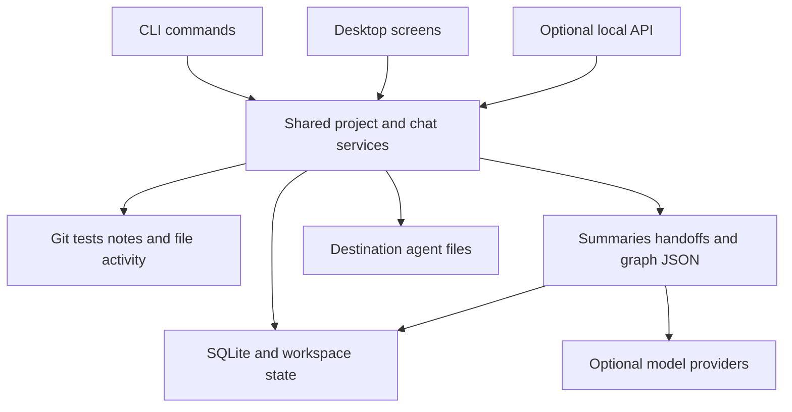
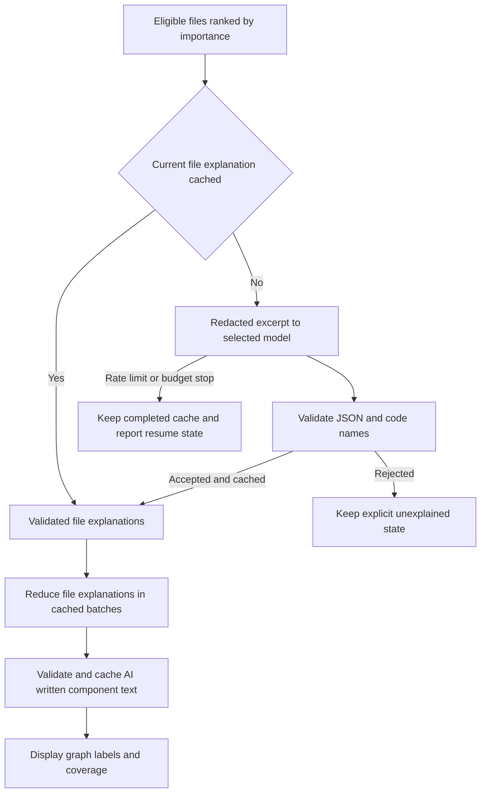

# ContextBridge End to End Workflow

**Current implementation guide | 18 November 2026 | Application version 0.1.0**

ContextBridge preserves the context of a software project when you switch coding agents, return after a break, or move a conversation into another chatbot. It combines recorded work, the current project and Git state, test results, and optional AI explanations into reusable handoffs and a project guide.

This document explains what the current CLI and desktop application do, how each workflow runs internally, what is stored, when a model is used, and where the prototype still has limits. It covers the current checkout, including the latest Flutter and Next.js explainer changes. The latest completed implementation test run recorded **686 passing tests and one optional ChromaDB test skipped**.

## 1 What the project gives you

ContextBridge has three connected uses:

1. **Preserve project history.** Record decisions, problems, todos, commit changes, explicitly watched file activity, and test results in a local workspace.
2. **Transfer useful context.** Build a compact, structured handoff and write it into the file the next coding agent reads, or copy it into a chatbot.
3. **Understand an unfamiliar project.** Read its documentation, summarize source files, inspect detected relationships, and optionally generate cached beginner explanations.

The application works without a model. Offline operation supplies project facts, deterministic handoffs, chat condensation, and structural graphs. A selected model adds constrained wording or explanations when the relevant action requests it. ContextBridge does not automatically read the private chat history of other applications, synchronize an agent's hidden memory, or edit your application code for you.

## 2 Current implementation status

| Area | Current state |
|---|---|
| Shared engine and workspace | Implemented through `ProjectService`, `ChatService`, local configuration and SQLite |
| Notes, Git capture and test recording | Implemented in the CLI and desktop application |
| Live file watcher | Implemented; starts only through `cb watch` or the GUI control |
| Structured project handoffs and chat imports | Implemented, with budgets, redaction and agent adapters |
| Provider settings and connection tests | Implemented; offline, Ollama and compatible hosted API workflows |
| Project summarizer | Implemented offline and with bounded model assistance, validation and caching |
| Project explainer | Working prototype with component, file and possible request-flow views |
| Explain project and component | Implemented with visible budgets, pacing, cached resume and rate-limit stops |
| Local API and Mermaid export | Existing implementations are present; further development and polish are deferred |
| Packaging | Launchers and build scripts exist; the planned Step 7 packaging rollout is not the current completed milestone |

A source checkout is currently a direct way to run the latest work. It requires Python and the selected optional dependencies. Local Ollama models and hosted subscriptions are separate from installing ContextBridge.

## 3 How the layers fit together

The CLI and desktop app call shared services. They do not each implement their own capture, summarization or graph engine. The optional local API calls the same services, but the desktop GUI does not need that HTTP server.



**The interface layer** collects options, displays progress and asks for product-level privacy confirmation where needed. **The service layer** coordinates project operations. **Core modules** inspect Git, files, symbols and command output. **Storage** retains sanitized records and derived caches. **Synthesis** selects evidence and constructs summaries. **Adapters** write the final handoff into the correct destination format.

The desktop uses PySide6. Slow operations run in background tasks, and results return to the UI thread. Rendering is separate from graph discovery, so a future frontend can reuse graph JSON without importing Qt.

## 4 A complete everyday workflow

The typical journey is: open a project, set up local context, work normally, record the evidence that matters, verify the project, understand any unfamiliar parts, and prepare a handoff.

```bash
# From the ContextBridge source checkout, launch the desktop app
uv run --extra gui cb gui

# In the project you want to track, using an installed cb command
cb init --no-hooks
cb log "Goal: Build a student calendar and task planner"
cb log "Store dates in UTC" --tag architecture
cb log "Fix the empty calendar screen" --tag todo
```

With `--no-hooks`, commit capture is not installed. Use `cb init` without that flag if you want the post-commit hook. Watching is a separate, explicit choice:

```bash
cb watch
# Work in another terminal or editor, then stop watching with Ctrl-C

cb run -- pytest -q
cb status
cb summarize --no-llm --budget 2000
cb handoff --to codex --dry-run
cb handoff --to codex
```

Replace `pytest -q` with your actual test command. Recording a test run requires running it through `cb run` or the GUI's test action; ContextBridge does not automatically know the result of every command you run elsewhere.

In the GUI, the same journey uses **Home**, **Notes**, **Changes**, **Project guide**, and **Hand off**. **Chat bridge** is a separate transfer workflow and can be used without opening a project.

## 5 First launch and provider selection

First-run setup explains that a model is optional. You can continue offline, select local Ollama, or configure a compatible hosted API endpoint and model.

For example, a Groq OpenAI-compatible configuration can use endpoint `https://api.groq.com/openai/v1` and model `openai/gpt-oss-120b`. This is a configuration example, not an assertion that the model or a quota is available on every account.

**Check connection** sends a tiny real generation request to the model and URL currently entered in the form. It is not merely a model-list lookup, and it contains no project context. Recognized reasoning models receive a larger completion allowance; the Groq GPT-OSS path requests low reasoning effort and reads final content rather than treating private reasoning as the answer. An empty final answer is reported clearly.

A successful check does not save the form. **Save model settings** applies the selection. Model-not-found errors identify the attempted model and endpoint and try to show available models.

The GUI and CLI share the configuration and credential mechanism. A GUI-saved endpoint key is available to CLI operations using the same endpoint and effective configuration. Global settings can be overridden by project settings and environment variables. `cb provider show` displays the effective selection without printing the key; `cb provider test` tests it with a tiny request.

## 6 What initialization creates

`cb init` locates the project root, creates or opens the ContextBridge workspace, migrates its database, and starts or resumes a session. Git-specific features are skipped for a project without Git.

| Local item | Purpose |
|---|---|
| `.contextbridge/state.db` | Notes, sessions, change records, tests, handoffs and derived summaries |
| `.contextbridge/state.json` | Project name, active session and branch, last-handoff metadata |
| `.contextbridge/config.json` | Project-specific settings overrides |
| `.contextbridge/cb.log` | Sanitized diagnostic logging |
| `.contextbridge/vector_db/` | Optional semantic-search index when that feature is used |

The old `.context/` workspace remains supported. Migration **copies rather than moves** it, uses SQLite backup handling for committed database state, and publishes the new workspace only after the copy is ready. The old folder is retained as a fallback. Neither migration nor ordinary initialization is meant to delete the user's previous workspace.

Sessions organize work by branch. Switching branches can start or resume another active session; returning to a branch resumes its existing active session. Archiving a session gives future work a fresh session while retaining its history.

Configuration is layered: built-in defaults, the platform-specific global configuration, project configuration, then supported environment overrides. Provider secrets are excluded from configuration files. API credentials use an endpoint-scoped secure OS keyring, with supported environment-key fallbacks for provider calls.

## 7 How work is captured

### Notes and decisions

`cb log` or the Notes screen records user-authored context with tags such as `note`, `architecture`, `bug`, `blocker` and `todo`. Text is sanitized before storage. Notes such as `Goal:`, `Done:` and `Next:` provide explicit material for later handoffs.

Todos have a lifecycle. Resolve completed work, dismiss an obsolete item, or supersede it with another logged item. The original record remains in history, while closed items stop appearing as active next steps.

### Commits

If installed, the Git post-commit hook calls the shared change logger. It discovers eligible changes, skips ContextBridge's own outputs and ignored or sensitive paths, and records metadata with numeric change summaries. A commit already recorded is not recorded again. A bounded backfill can recover recent missed commits, such as work replayed during a rebase.

The current automatic commit log stores paths and numeric summaries, not raw file bodies or symbol signatures. Live Git inspection can still compute richer information in memory for the current project view. This is different from older architecture notes that described persisted diff excerpts.

### Explicit live watching

The watcher polls file metadata: size, modification/change timestamps and inode. It does not read source contents. Defaults are a one-second poll, a two-second quiet debounce and a maximum batch age of thirty seconds.

Several saves are combined into one batch. A recorded example might mean that five distinct paths changed during a thirty-second interval, with per-path added/modified/deleted and size summaries. A checkout, formatter or dependency operation does not need to produce one database row per save event.

The watcher ignores ContextBridge folders, agent output files, `cb.log`, sensitive files, symlinks, environment/build/cache folders and applicable ignore rules. A rename can appear as one deletion and one addition. Restarting establishes a new baseline; work done while watching was stopped is not retroactively attributed to it.

### Test and command runs

`cb run -- COMMAND` streams command output and preserves its exit code. The parser recognizes common pytest, Jest, Vitest, Go and Cargo test output. It records counts when known, selected failures, the command, exit code and run time. Unrecognized output is reported conservatively rather than inventing a passing count.

Handoffs show the age of the last recorded test run and mark it stale when source files changed afterward. A green result describes that recorded run, not a permanent property of the repository.

## 8 How offline project summarization works

A fresh repository can be summarized even if there are no logged notes. The summarizer inventories eligible paths, reads documentation and dependency manifests, detects languages and entry points, extracts available symbols/imports, and consults recent Git history.

Python uses AST inspection; supported change-symbol analysis also uses bundled tree-sitter grammars. Unsupported or unparseable code receives conservative descriptions. Source is parsed as data, never executed for analysis.

The resulting project summary includes Goal, languages/dependencies, file purposes, a folder-level view, Git history and analysis counts. The regular command's `--budget` controls its rendered output length. `--no-llm` forces offline operation, and `--refresh` bypasses successful summary reuse within the run's other limits.

```bash
cb summarize --no-llm --budget 2000
cb summarize --budget 2000
cb summarize --explain --budget 2000
```

Regular model-assisted summarization ranks at most eight source files. It splits files into small sanitized chunks and requests structured JSON containing a purpose, key symbols and dependencies. Purposes are selected from supplied evidence; names and imports must belong to that evidence. Invalid structured output retries once, then falls back to offline material. Chunk results are merged locally.

This regular command is distinct from the GUI's **Explain project** action, which has no eight-file model-selection cap.

## 9 How a project handoff is built

A handoff has a prepare phase and a write phase.

1. Validate the destination agent and load effective settings.
2. Resolve the current session and assemble notes, recorded change history, test results and live project state.
3. Reuse offline and cached project summaries to improve Goal and file purposes, including for a project with little recorded history.
4. Select the latest detailed work, compact older work, remove closed or superseded todos, and limit commit detail.
5. Reserve space for Goal, Done, Decisions and Next steps before filling the reading list.
6. Render a deterministic document within the chosen output budget.
7. If explicitly enabled, attempt constrained model polishing; otherwise go straight to preview, copy or write.

The default output budget is approximately **2,000 tokens**, configurable in settings or with `--budget`. The source agent comes from an explicit `--from`, an available environment signal, or `unknown`. A previous destination does not prove which agent is currently operating. Matching source and destination produce a warning.

The document uses Goal, Done, Decisions, Current state, Open problems, Next steps, and Files to read first. With few logged notes, it can add What each part does. Missing logged facts are stated explicitly. The reading list prioritizes up to eight important source files over tests, and avoids known one-line trivial edits. Tests are aggregated rather than expanded into function names.

```bash
cb handoff --to codex --dry-run --budget 2000
cb handoff --to cursor --from codex
cb handoff --copy --budget 2000
cb handoff --to codex --dry-run --polish
```

A dry run does not write an agent handoff file. It can still build or reuse local derived context. A real write uses the adapter and records the payload and token statistics in SQLite and the last-handoff pointer.

Model polishing is off by default. When requested, it preserves factual words, paths, numbers, negations and line order while allowing restricted spacing and punctuation changes. Its visible effect can therefore be small. Invalid results retry once and fall back to the deterministic document.

## 10 Where the next coding agent reads the handoff

| Destination | Output path | Write behavior |
|---|---|---|
| Claude Code | `CLAUDE.md` | Updates a managed context block while preserving other content |
| Codex | `AGENTS.md` | Updates a marked handoff block while preserving project instructions |
| Cursor | `.cursor/rules/handoff.mdc` | Writes a ContextBridge-owned rule |
| Kiro | `AGENTS.md` | Uses the shared marked handoff block |
| Generic tools including Aider or OpenCode | `HANDOFF.md` | Writes the portable handoff document |

The files are normal working-tree files. The next agent reads them according to that tool's own behavior or your instruction to open the file. ContextBridge does not transfer the previous model's private state. Ownership checks protect unrelated destination files; explicit force options exist for intentional replacement. Cleanup removes managed output according to adapter rules.

## 11 How chat transfer works

`cb import-chat` reads pasted standard input, a text/Markdown file, or the clipboard. It requires neither project initialization nor a model.

```bash
cb import-chat --file conversation.txt --budget 2000
cb import-chat --clipboard --copy
```

The parser recognizes speaker labels such as User/Assistant, User prompt/Response and You said/ChatGPT said. Wrapped lines are joined, chronology is retained, URLs/tool noise are filtered, repeated lines are deduplicated and secrets are redacted.

The first substantial user request supplies a concise Goal, approximately forty words or fewer. Current state combines the latest user request with a short extract from the latest assistant response. Done extracts assistant completion claims into neutral wording; these remain **claims in the conversation**, not independently verified work. Next steps come from explicit final follow-ups or open questions, with a clear empty state when none exist. Mentioned filenames appear under Files.

Short input or text without recognizable turns produces a warning. Input is bounded to 100,000 characters. The GUI additionally imports selectable-text PDFs and can save a handoff as a PDF. Scanned-image OCR is not included. Users can pin facts and edit the preview before copying it into another chatbot. Text remains local until the user chooses to share or export it. The optional browser extension can export selected text on an explicit click; it is not automatic access to every chatbot conversation.

## 12 How the explainer graph works

`project_map.py` scans bounded source files and produces plain graph data. Nodes contain stable IDs, a kind, relative path, folder group, purpose, related files and an optional separately labeled AI explanation. Edges represent detected imports and statically resolved Python calls.

The GUI renderer consumes this JSON. It paints cream cards, titles, explanations, file counts and detected connections; clicking a node shows its details. Rendering itself does not inspect source code or ask a model for answers.

- **Project overview** groups source files into five to eight components when the real folder structure supports that many. Small projects can have fewer. Root-level source files are named Project root. Overview arrows come only from detected imports.
- **Inside one file** shows available file/symbol details and connections. Uses and Used by appear only when detected; otherwise the page says Connections not detected.
- **How a request travels** shows possible paths reachable from recognized starting files. With no detected entry point, the page explains the limitation and permits a starting-file choice. It is not an execution trace.

Unexplained cards say **Not explained yet** and provide Explain actions. Folder descriptions are not guessed from folder names or copied from one representative file. They appear only when a validated reduction of file explanations is available. Partial coverage is shown as explained files versus the component's analyzed file count.

Node caps collapse omitted nodes into a +N more item. A missing arrow does not prove that two parts are unrelated: dynamic behavior, unsupported syntax, scan limits or an unsupported language may prevent detection.

## 13 Which languages and frameworks are understood

| Language or convention | Graph import resolution | Entry points and relationship limits |
|---|---|---|
| Python | Local imports, including relative modules | Package scripts and common main/app/server files; statically resolved calls are available |
| Dart and Flutter | Relative imports and `package:` imports within the current package, using the pubspec name | `lib/main.dart` startup is recognized; Dart call graphs are not implemented |
| JavaScript and TypeScript including JSX and TSX | Literal ES imports and `require`, relative paths, config aliases and index files | Package main/bin, index/main files, Next app-router conventions and some literal Express routes; JS/TS calls are not resolved |
| Go and Rust | Source-file boxes; graph imports are not resolved | Change-symbol extraction exists separately, but does not imply a graph import or call engine |
| Java and other unsupported graph cases | File-level display where scanned; connections may be absent | Unsupported behavior is reported rather than filled with guessed arrows |

For TS/JS, the resolver reads `tsconfig.json` or `jsconfig.json`, handles JSONC comments, `baseUrl`, wildcard `paths`, target fallbacks and index files. Local config inheritance is bounded and stays inside the project. Package-based config inheritance and arbitrary bundler/plugin aliases are outside this prototype.

Next.js labels use file conventions: `app/admin/page.tsx` becomes **Admin page (/admin)**, `app/layout.tsx` becomes **Root layout (/)**, and `app/api/events/route.ts` becomes **API route (/api/events)**. Route-group and parallel-slot folders are omitted from displayed URLs. Literal Express app/router registrations and Flask decorators contribute route labels. Dynamic construction, mounted-router prefixes and full framework runtime behavior are not reconstructed.

Change-symbol parsing and graph parsing are separate capabilities. For example, the change parser recognizes additional JS/TS filename extensions, while the graph scanner currently accepts its own smaller extension set. Supported syntax is not a promise of complete language semantics.

## 14 How Explain file and Explain project use a model

**Explain this file** sends a small sanitized excerpt of the selected file, its purpose and allowed code names. The provider returns JSON with explanation text and declared references. The text is checked against the file's symbols/imports and filename; invented or malformed references cause the explanation to be dropped. Accepted beginner wording is labeled AI-written and cached separately from the grounded purpose.

**Explain project** runs this file-explanation stage in importance order, then reduces the available file explanations into component summaries. **Explain component** runs the same pipeline for that component's files. The GUI asks for privacy confirmation and shows the budgets before starting either action.



Folder reduction prompts contain file explanations, not source code. They instruct the model to use the supplied facts and not infer behavior from folder/file names. Large groups are reduced in small batches; intermediate reduction results are also cached. Folder text uses the same code-name validation as file explanations.

Name validation reduces invented identifiers; it is not a formal proof that every natural-language interpretation is correct. AI-written text remains distinguishable from extracted project facts and should be reviewed.

## 15 Budgets pacing and resume

Three budgets serve different purposes and should not be confused.

| Budget | Default | What it controls |
|---|---|---|
| Handoff output | About 2,000 tokens | Length of the final transfer document |
| Regular summarize model work | 12 requests; at most 8 ranked source files | Optional per-chunk assistance in `cb summarize` |
| GUI Explain project or component | 20 requests and 40,000 reserved tokens | Combined file explanations, retries and component reductions |

The project/component dialog permits 1-200 requests and 1,000-1,000,000 reserved tokens. Each request reserves estimated prompt tokens, a schema allowance and the maximum output allowance. This is a conservative local estimate, not an invoice or exact provider usage report. Retries and reduction requests count against the same limits. Cached work uses no generation requests.

Requests are paced using configured spacing and provider headers such as Retry-After and remaining/reset limits. The normal summarizer can perform bounded backoff. **Explain project stops on a rate-limit response, or an active saved cooldown, with a clear retry time and progress-cached message.** It does not silently keep spending requests on the next files. Rerun the action to resume after the cooldown.

File caches use content hashes and provider/model/profile information. Folder cache keys include member content hashes and explanation inputs. A change to one file invalidates its explanation and the affected component summary. An unchanged rerun can use zero model requests, including when component reductions are already complete.

The summarizer still has inventory safety limits: 600 paths by default, 256,000 bytes per file and 8,000,000 total source bytes. The graph scanner separately bounds source files to 180, directories to 200, file size to roughly 64 KiB and total source to roughly 2 MB. Graph views allow 2-60 nodes; the GUI uses smaller defaults. Request budgets do not remove those safety bounds.

## 16 What is stored and what is not

The current SQLite schema has six versioned migrations and these main record types:

| Table | Retained data |
|---|---|
| `sessions` | Branch-associated work sessions and status |
| `decision_logs` | Sanitized notes, tags, todo status and supersession links |
| `file_changes` | Paths, change types and summaries |
| `change_batches` | Batch timing, event counts and per-path metadata summaries |
| `test_runs` | Commands, exit codes, counts and bounded failure details |
| `handoffs` | Generated payloads, destination paths and token statistics |
| `file_summaries` | Derived purposes, symbols/imports and partial summary results |
| `file_explanations` | Validated beginner text and reference metadata |
| `component_explanations` | Validated folder reductions and intermediate cached results |
| `provider_limits` | Persisted pacing/cooldown state |

Automatic change logging does not persist source contents. Source excerpts and full prompts used for generation are not stored as cache records. User notes, test failure details, generated handoffs and derived explanations are retained text, and are sanitized. The optional vector index is derived from sanitized SQLite notes and changes; it is not the main source of truth.

The database is local SQLite, not an encrypted cloud memory service. Its migrations preserve existing records as the schema grows. Ordinary file edits invalidate derived labels, not the original user-authored work history.

## 17 When anything leaves the machine

| Action | Network or external transfer |
|---|---|
| Notes, normal capture, test recording, deterministic handoff, chat condensation and graph refresh | No hosted model request |
| Provider connection test | Tiny test prompt to the selected endpoint; no project code |
| Hosted file summarization or explanation | Selected redacted source excerpts and allowed names |
| Hosted folder reduction | Cached file explanations and validation names; no source code in the reduction prompt |
| Explicit handoff polishing | Selected handoff wording |
| Local Ollama generation | Requests to the configured local Ollama endpoint |
| Optional semantic search | Local index; the default embedding model may require an initial download |
| Clipboard, file export and destination adapter output | Shared only through the user's chosen copy/export/write action |

Sensitive filenames, ignored folders and symlinks are excluded from analysis paths. Redaction runs on model prompts and stored text. Pattern-based redaction is best-effort; it does not establish that arbitrary code contains no sensitive business information. The privacy choice still matters even when obvious credential strings are removed.

Saving a provider does not automatically polish every handoff. Graph refreshes use local or cached data and do not start model requests. The optional watcher and local API also require explicit startup.

## 18 Optional interfaces currently deferred

A FastAPI implementation already exists for status, graph JSON, Mermaid text, cached summaries and handoff preview/write operations. `cb serve` binds only to `127.0.0.1`, generates a random token for that server session and requires it as a bearer token on every HTTP request. Restarting changes the token. There is no unauthenticated documentation exception.

This API is not required by the current Qt GUI. Its further development is deferred, along with extra views and Mermaid polish. The existing Mermaid exporter constructs and validates graph syntax deterministically; models do not generate its diagram source.

macOS launch and build code exists. A finished installation experience, signing and distribution work should be assessed separately from the currently implemented explainer prototype. Local models are not silently bundled or downloaded by opening the guide.

## 19 What happens when something is missing

| Condition | Current behavior |
|---|---|
| No model selected | Offline summaries and handoffs work; explanation actions direct the user to provider settings |
| Missing key, endpoint failure or model error | Clear provider error or offline fallback according to the action; existing logs/cache remain usable |
| Invalid model JSON | Bounded retry, then retained offline/unexplained state |
| Invented code references | Explanation is dropped rather than presented as accepted text |
| Rate limit during Explain project | Stop, report retry time, keep completed file/reduction cache |
| Request or reserved-token budget exhausted | Stop model work and retain progress for another run |
| Source changed after the test run | The recorded test result is marked stale |
| Unsupported imports or dynamic calls | Explicit missing-connection notice; no invented relationships |
| No detected entry point | Explain the limitation and allow a starting-file choice |
| Empty or bounded scan | Show a guided empty state or report the limit; do not imply full repository coverage |
| Semantic-search dependency unavailable | Keyword-search fallback; main SQLite workflows still work |
| Chat lacks turn labels or is very short | Warning and conservative extraction |

The GUI can still contain a name-based inference table under its broader guide content. That legacy table is separate from the component-description pipeline; it should not be mistaken for a validated AI-written component explanation.

## 20 Command reference and practical sequence

| Task | Command or GUI action |
|---|---|
| Open the latest desktop UI from this checkout | `uv run --extra gui cb gui` |
| Initialize without a commit hook | `cb init --no-hooks` |
| Initialize with the optional commit hook | `cb init` |
| Add an architecture decision | `cb log "Use SQLite for local state" --tag architecture` |
| Watch file activity explicitly | `cb watch` |
| Record a test command | `cb run -- pytest -q` |
| Review captured context | `cb status` |
| Create an offline project overview | `cb summarize --no-llm --budget 2000` |
| Add optional per-file beginner text in regular summarization | `cb summarize --explain` |
| Explain the project beyond eight source files | GUI Project guide, Explain project |
| Inspect or test effective provider settings | `cb provider show` and `cb provider test` |
| Preview a coding-agent handoff | `cb handoff --to codex --dry-run` |
| Write a handoff | `cb handoff --to codex` |
| Copy a portable handoff | `cb handoff --copy` |
| Import a chat | `cb import-chat --file conversation.txt --copy` |
| Find previous notes and changes | `cb search "calendar"` |
| Resolve an active todo | `cb todo resolve ITEM_ID` |
| Archive a session or clean managed handoffs | See `cb clear --help` and select the intended operation |

For a fresh Flutter or Next.js project: open it, initialize local tracking, choose offline or a provider, and refresh the guide. First inspect the detected structure. If you want beginner explanations, run Explain project with visible budgets and review the privacy notice. Resume if a quota stop occurs. Record decisions and tests during development. Preview a deterministic handoff before writing it for the next agent.

## 21 Code map for understanding the implementation

| Source path | Main responsibility |
|---|---|
| `contextbridge/main.py` and `cli/` | CLI registration, options and presentation |
| `contextbridge/service.py` | Shared project/chat orchestration and prepare/write operations |
| `contextbridge/core/change_logger.py` | Commit ingestion with numeric metadata |
| `contextbridge/core/watcher.py` | Explicit polling, debounce, batching and self-output exclusions |
| `contextbridge/core/git_observer.py` | Git state, diffs, history and hook management |
| `contextbridge/core/ast_parser.py` | Supported source-symbol extraction |
| `contextbridge/core/web_facts.py` | TS/JS config aliases and cheap framework-route facts |
| `contextbridge/core/sanitizer.py` | Sensitive-file filtering and text redaction |
| `contextbridge/storage/workspace.py` | Workspace discovery, copy migration and session pointers |
| `contextbridge/storage/db.py` | SQLite schema, migrations, records and derived caches |
| `contextbridge/synthesis/project_summary.py` | Offline/model summaries, explanation requests, reduction and budgets |
| `contextbridge/synthesis/explanations.py` | Conservative code-name and reference validation |
| `contextbridge/synthesis/context_builder.py` | Current and historical context assembly |
| `contextbridge/synthesis/compressor.py` and `document.py` | Grounded handoff selection, section budgets and constrained polish |
| `contextbridge/project_map.py` | UI-independent graph discovery, views, IDs and export |
| `contextbridge/gui/diagrams.py` and `gui/pages/guide.py` | Card rendering, selection, explanation actions and UI progress |
| `contextbridge/providers/` | Settings, endpoint-key credentials, HTTP generation and rate limits |
| `contextbridge/adapters/` | Destination-specific handoff injection and cleanup |
| `contextbridge/chat_bridge.py` and `chat_files.py` | Turn parsing, condensation and local text/PDF import |
| `contextbridge/local_api.py` | Existing optional authenticated loopback API |

Start with `service.py` to see the full user journey, then follow the relevant capture, synthesis or graph module. This current guide supersedes older architecture descriptions where defaults or storage behavior differ.

## 22 Validation and remaining prototype limits

The latest implementation run recorded **686 passing tests, one optional ChromaDB test skipped and one dependency deprecation warning**. Ruff, formatting checks, mypy and the GUI self-test also passed. These are the completed implementation checks, not a new test run performed just to create this document.

The current Next.js fixture covers twelve source files, app-router labels, aliases, index resolution and root-level files. Flutter fixtures cover package/relative imports, startup detection and missing-connection behavior. Explanation tests use mocked providers and cover privacy filtering, structured validation, invented names, pacing, requests beyond eight files, token/request stops, rate-limit stops and cache resume. Unchanged cached runs use zero generation requests; editing one file invalidates that file and its component reduction.

The prototype still has bounded scans, partial static-language coverage, no general runtime tracing, no complete router-mount reconstruction and no guarantee that AI prose is semantically correct merely because names validate. The next useful review is the quality of explanations and navigation on a real project, within the current scope. API expansion, additional views, Mermaid polish and distribution work remain separate follow-up work.

### Terms used in this document

- **Handoff:** a compact transfer document for another agent or chatbot.
- **AST and tree-sitter:** parsers that inspect source structure without running the project.
- **Content hash:** a fingerprint that changes when file contents change.
- **Cache:** previously validated results reused to avoid repeating model requests.
- **Map reduce:** explain files individually, then summarize those explanations into larger components.
- **Rate limit:** the provider's restriction on requests or tokens over time.
- **Reserved tokens:** a conservative estimated per-run allowance, not exact billed usage.
- **Adapter:** a writer that places the handoff in a particular agent's expected file format.
- **UI independent engine:** shared data and operations that do not require the desktop renderer.
